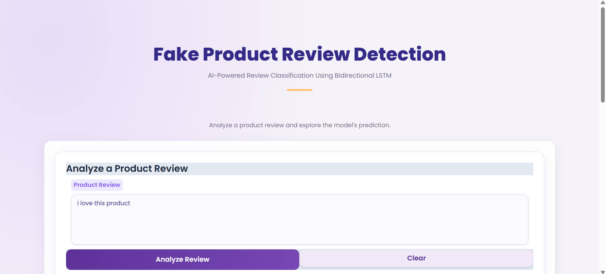
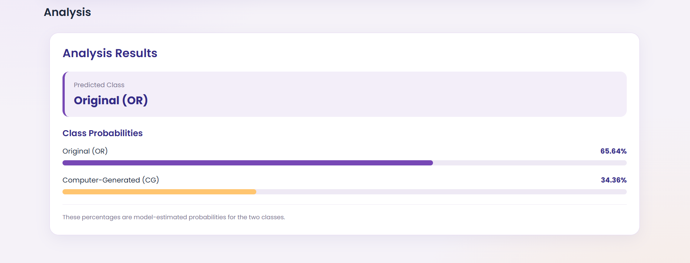
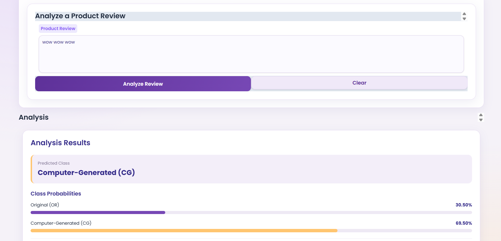
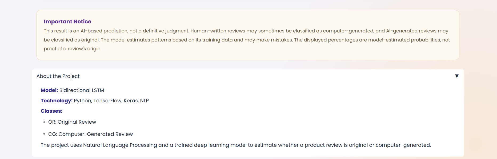

# Fake Product Review Detection

A machine learning project that classifies product reviews as **Original (OR)** or **Computer-Generated (CG)** using Natural Language Processing (NLP) and a Bidirectional Long Short-Term Memory (BiLSTM) network.

## Project Overview

Online shoppers use product reviews to make purchasing decisions. This project trains a text classification model to recognize patterns associated with computer-generated reviews.

The dataset labels are the target used for training; predictions should be treated as model estimates, not proof that a review is fraudulent.

## Dataset

- **Rows:** 40,412 product reviews after removing 20 duplicate review texts (the original file has 40,432 rows).
- **Labels:** 20,197 CG and 20,215 OR.
- **Columns:** `category`, `rating`, `label`, and `text_`.
- The dataset used in this notebook is `fake reviews dataset.csv`. Direct link to the CSV file: [fake reviews dataset.csv](https://github.com/SayamAlt/Fake-Reviews-Detection/blob/main/fake%20reviews%20dataset.csv).
- The Kaggle competition shown in the project research requires an invitation to join, so this project uses the accessible copy of the dataset above.
- `CG` means computer-generated; `OR` means original/human-written, according to the dataset.

## Method

1. Inspect the data, label counts, missing values, categories, and review lengths.
2. Remove duplicate review texts before splitting the data.
3. Clean review text by lowercasing, removing punctuation and short tokens, and filtering English stop words.
4. Split the data into training and test sets using an 80/20 stratified split (`random_state=42`).
5. Convert text to integer sequences with a Keras tokenizer and pad/truncate each review to 150 tokens.
6. Train a Bidirectional LSTM with an embedding layer, dense layer, dropout, and sigmoid output. EarlyStopping monitors validation loss on a 10% validation split taken from the training data only, and restores the best weights.
7. Evaluate the model on the held-out test set using accuracy, precision, recall, F1-score, and a confusion matrix.

## Results

With EarlyStopping, the model achieved:

- **Test Accuracy:** 91.28%
- **Test Loss:** 0.2134
- **Macro-average F1-score:** 0.91
- **Test Set:** 8,083 reviews

## Application Screenshots

The following screenshots show the application interface and examples of model predictions.

### Main Interface

### Original Review Prediction

### Computer-Generated Review Prediction

### Notice and About Project

## Run the Notebook

1. Open `Fake_Product_Review_Detection.ipynb` in Google Colab.
2. Upload `fake reviews dataset.csv` when the notebook asks for it.
3. Run the notebook cells from top to bottom. The training cell takes a few minutes.
4. Read the final classification report and confusion matrix for test performance.

Exact results may vary slightly between runs because neural network training is not fully deterministic.

## Project Files

- `Fake_Product_Review_Detection.ipynb` — complete analysis, preprocessing, model training, and evaluation.
- `README.md` — project summary, data details, method, results, and run instructions.
- `requirements.txt` — Python package versions used by the project.
- `project_artifacts.zip` — trained model, tokenizer, and model metadata.
- `screenshots/` — application interface and prediction screenshots.

## Limitations

This is an educational classifier trained on one labeled dataset. Its labels describe the dataset's distinction between computer-generated and original reviews; they do not independently verify a reviewer's identity, purchase, or intent.

The model may misclassify reviews from other products, platforms, or writing styles.

## References

**Dataset paper:**

Salminen, J., Kandpal, C., Kamel, A. M., Jung, S., & Jansen, B. J. (2022). Creating and detecting fake reviews of online products. *Journal of Retailing and Consumer Services, 64*, 102771.

https://doi.org/10.1016/j.jretconser.2021.102771

**Course workflow:**

The project adapts the workflow taught in Coursera's NLP Fake News Detector hands-on course (text cleaning, tokenization, padding, recurrent models, and evaluation) to product review classification. The model architecture and task are tailored to this product-review dataset.

## Saved Model Artifacts

`project_artifacts.zip` contains:

- `fake_review_bilstm.keras` — trained Keras model.
- `tokenizer.json` — matching tokenizer.
- `requirements.txt` — pinned package versions.
- `model_metadata.json` — evaluation and model settings.

Use these artifacts with the same preprocessing and sequence length used during training. The notebook remains the recommended way to reproduce the full workflow.
